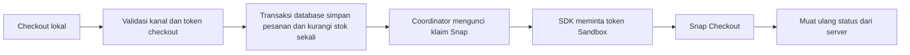
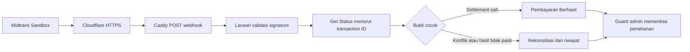

# Midtrans Snap untuk lingkungan Sandbox

1. Siapkan lingkungan staging HTTPS dengan database dan data uji terpisah. Cadangkan database tujuan. Jalankan migration Midtrans 000001, 000002, dan 000003 sesuai urutan migration yang belum diterapkan. Koordinasikan pergantian versi web dan worker agar semua instance memakai guard yang sama.
2. Gunakan kredensial Sandbox di pengelola rahasia staging. Pertahankan `MIDTRANS_IS_PRODUCTION=false`. `MIDTRANS_SANDBOX_CHANNELS` berisi kandidat uji. Biarkan `MIDTRANS_SANDBOX_VERIFIED_CHANNELS` kosong. Masukkan kode kanal ke daftar tersebut hanya setelah tes Sandbox kanal itu berhasil dan disetujui. Aplikasi juga membatasi kanal ke yang didukung verifikasi server.
3. Setelah mendapat persetujuan, di Dashboard **Sandbox** buka **Settings → Payment Settings → Payment Notification URL**. Gunakan `https://<host-staging>/api/webhooks/midtrans`. Pastikan endpoint publik menerima POST melalui TLS tanpa sesi browser, autentikasi interaktif, atau redirect. Pengiriman terautentikasi diverifikasi oleh aplikasi. [Panduan Snap](https://docs.midtrans.com/docs/snap-snap-integration-guide) · [Payment Settings](https://docs.midtrans.com/docs/payment-settings)
4. Gunakan simulator Sandbox dan pesanan uji terisolasi dengan akses terbatas. Pertahankan Checkout pelanggan tertutup. Periksa apakah kanal muncul di Snap, lalu cocokkan notifikasi, Get Status server, nominal, dan settlement. Untuk Other QRIS, konfirmasi acquirer GoPay atau ShopeePay QRIS di Sandbox dan gunakan simulator resmi. Mandiri Bill Payment memakai `echannel` dengan Bill Key dan Biller Code dari Snap. Verifikasi server membedakan `echannel` dari `bank_transfer`. [Pengujian Sandbox](https://docs.midtrans.com/docs/testing-payment-on-sandbox) · [Other QRIS](https://docs.midtrans.com/reference/other-qris)
5. Periksa audit admin dan pastikan refund, reversal, dan konflik tetap tertahan. Kasus tanpa ID transaksi yang tersimpan memerlukan pemeriksaan manual. Tindakan pemeriksaan ulang dapat menutup percobaan gagal yang terbukti berbeda dari pembayaran sukses.

Rollback operasional dimulai dengan mengosongkan `MIDTRANS_SANDBOX_VERIFIED_CHANNELS` dan menghentikan pemenuhan Midtrans yang terdampak. Pertahankan tabel audit dan penanda penahanan saat menyelidiki regresi. Mode produksi memerlukan validasi dan persetujuan terpisah.

## Arsitektur pembayaran

`Menunggu` berarti belum ada settlement yang diterima server. `Berhasil` berarti pembayaran pernah terverifikasi. Refund dan reversal tetap dapat menahan pemenuhan walaupun status lokal masih `Berhasil` dan kasus telah ditutup. HTTP 400 menunjukkan payload ditolak, 403 menunjukkan signature ditolak, 413 menunjukkan payload terlalu besar, 429 menunjukkan batas laju tercapai, dan 503 menunjukkan kegagalan sementara. Timeout atau 404 dari Get Status tidak membuktikan pembatalan.

## Menjalankan proxy dan tunnel di Windows

Untuk demo Sandbox yang memakai Checkout di port 8000 dan `db_ppl`, set `PPL_MIDTRANS_WEBHOOK_UPSTREAM=127.0.0.1:8000` pada proses Caddy. Pastikan proses Checkout bertanda `MIDTRANS_IS_PRODUCTION=false` dan memakai kredensial Sandbox. Gunakan Payment Notification URL publik yang mengarah ke Caddy; hanya POST `/api/webhooks/midtrans` yang diteruskan. Tanpa override, Caddy memakai backend SQLite uji di port 8788.

1. Gunakan proses Laravel Sandbox tersendiri di `127.0.0.1:8788`, dengan front controller standar `public/index.php` dan SQLite uji yang sudah ada di `%TEMP%\karunia-midtrans-sandbox-webhook\webhook.sqlite`. Atur environment di shell khusus Sandbox sebelum menjalankan Laravel. Gunakan `DB_CONNECTION=sqlite`, `DB_DATABASE` dengan path SQLite tersebut, `DB_URL=(null)`, `MIDTRANS_IS_PRODUCTION=false`, `MIDTRANS_SANDBOX_VERIFIED_CHANNELS=(empty)`, `APP_DEBUG=false`, `CACHE_STORE=database`, dan `DB_CACHE_CONNECTION=sqlite`. Arahkan `APP_CONFIG_CACHE` dan `APP_ROUTES_CACHE` ke masing-masing path Sandbox yang belum berisi file cache. Jalankan `php artisan serve --host=127.0.0.1 --port=8788 --no-reload` di shell tersebut. Validasi dengan `caddy validate --config ops/midtrans/Caddyfile --adapter caddyfile`, lalu jalankan `caddy run --config ops/midtrans/Caddyfile --adapter caddyfile`. Caddy meneruskan POST langsung ke route Laravel. Apache dan Laravel utama memiliki proses terpisah.
2. Pastikan Caddy hanya mendengarkan di `127.0.0.1:8787`. Uji POST JSON kosong ke webhook, yang seharusnya mendapat 400. GET webhook, GET atau POST ke login/admin, dan path lain seharusnya mendapat 404. Payload JSON lebih dari 64 KiB seharusnya mendapat 413. Laravel membatasi webhook hingga 120 request per menit per alamat yang terlihat, yang menjadi satu kuota bersama ketika tanpa trusted proxy.
3. Jalankan `cloudflared tunnel --protocol quic --url http://127.0.0.1:8787`. Ulangi pengecekan pada hostname HTTPS sementara. Cocokkan respons JSON Laravel dan entri pembatas laju di cache SQLite uji untuk membuktikan bahwa POST mencapai instance terisolasi. Pertahankan proses cloudflared yang sama saat memperbarui Caddy agar hostname tetap berlaku.
4. Atur hanya **Payment Notification URL** Sandbox setelah HTTPS lulus. Setelah sesi, hentikan tunnel dan copot URL sementara dari Dashboard. Gunakan host stabil untuk penggunaan berkelanjutan. [Cloudflare Quick Tunnels](https://developers.cloudflare.com/tunnel/get-started/quick-tunnels/)

## Backup, pemulihan, dan bukti

Simpan dump lengkap di luar document root dengan akses akun terbatas. Gunakan `mysqldump --single-transaction --quick --routines --events --triggers` dengan output ke file, lalu pulihkan ke instance MariaDB terisolasi. Bandingkan jumlah pesanan, pembayaran manual, produk, serta checksum tabel utama sebelum dan sesudah migration. Jika pemeriksaan setelah perubahan gagal, hentikan pemenuhan Midtrans dan analisis dari salinan pemulihan. Pemulihan ke database utama memerlukan peninjauan terpisah.

Verifikasi MASTER FINAL mencakup **136 tes dan 1.389 assertion**, termasuk pengujian lock dengan dua koneksi MariaDB dan settlement Mandiri menggunakan gateway tiruan. Pada Quick Tunnel, jalur selain webhook mengembalikan 404. POST webhook sintetis mendapat 400 untuk JSON kosong, 403 untuk signature palsu, dan 413 untuk payload di atas 64 KiB. Bukti Sandbox nyata dicatat per kanal setelah penerimaan webhook dan Get Status cocok. Catat kode pesanan uji, kanal, waktu, hasil dan status HTTP. Singkirkan token, signature, informasi akun, dan data pelanggan dari bukti.

## Checklist screenshot PPL

- [ ] XAMPP berjalan.
- [ ] Laravel berjalan di localhost.
- [ ] Pengaturan kanal Sandbox.
- [ ] HTTPS tunnel aktif.
- [ ] Payment Notification URL Sandbox.
- [ ] Checkout pelanggan.
- [ ] Snap Checkout.
- [ ] Simulasi pembayaran Sandbox.
- [ ] Penerimaan webhook.
- [ ] Status pembayaran diperbarui.
- [ ] Halaman rekonsiliasi admin.
- [ ] Hasil pengujian otomatis.

Sebelum Production, verifikasi host HTTPS stabil, kunci dan kanal Production terpisah, proteksi endpoint dan batas laju, pengujian settlement dan refund per kanal, monitoring notifikasi gagal, backup yang telah diuji, serta prosedur rekonsiliasi dan pemulihan. Quick Tunnel localhost bergantung pada proses lokal, jaringan, dan hostname yang berubah saat dijalankan ulang.
